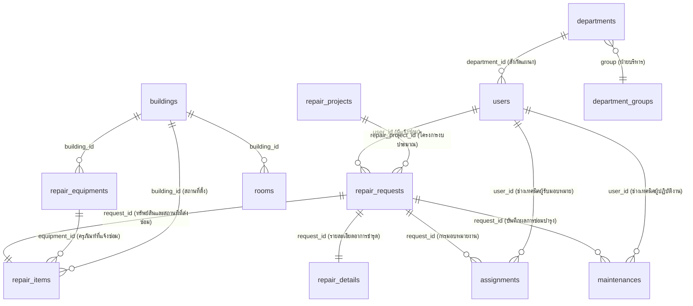

# พจนานุกรมข้อมูล (Data Dictionary)

## ระบบแจ้งซ่อมงานศูนย์ข้อมูลเทคโนโลยีสารสนเทศ วิทยาลัยเทคนิคยะลา
- **ชื่อฐานข้อมูล:** `S406665005_db` (MySQL 8.0 / InnoDB / utf8mb4_unicode_ci)
- **โฮสต์เซิร์ฟเวอร์:** `student.yru.ac.th` (พอร์ต 3306)
- **จำนวนตารางระบบงานจริง:** 17 ตาราง (ไม่รวมตารางระบบภายในของ Laravel Framework)
- **โครงสร้างแยกตาราง 7 ตารางหลัก:** `repair_requests`, `device_types`, `asset_kinds`, `repair_items`, `repair_details`, `assignments`, และ `maintenances` (ตามข้อกำหนดสถาปัตยกรรม 3NF)

---

## สารบัญตารางฐานข้อมูลระบบงาน (17 ตาราง)

### หมวดที่ 1: ระบบงานแจ้งซ่อมและทรัพย์สิน (7 ตารางหลักที่ทำการแยกและปรับปรุงล่าสุด)
1. [`repair_requests`](#1-ตาราง-repair_requests) : ตารางแจ้งซ่อม (Repair Requests Table)
2. [`device_types`](#2-ตาราง-device_types) : ตารางประเภททรัพย์สิน (Device Types Table)
3. [`asset_kinds`](#3-ตาราง-asset_kinds) : ตารางชนิดทรัพย์สิน (Asset Kinds Table)
4. [`repair_items`](#4-ตาราง-repair_items) : ตารางชนิดทรัพย์สินที่แจ้งซ่อม (Repair Items Table)
5. [`repair_details`](#5-ตาราง-repair_details) : ตารางรายละเอียดแจ้งซ่อม (Repair Details Table)
6. [`assignments`](#6-ตาราง-assignments) : ตารางมอบหมายงาน (Assignments Table)
7. [`maintenances`](#7-ตาราง-maintenances) : ตารางบันทึกการแจ้งซ่อม (Maintenances Table)

### หมวดที่ 2: ระบบครุภัณฑ์ โครงการ และงบประมาณ (5 ตาราง)
8. [`repair_equipments`](#8-ตาราง-repair_equipments) : ตารางข้อมูลครุภัณฑ์และอุปกรณ์ (Repair Equipments Table)
9. [`repair_projects`](#9-ตาราง-repair_projects) : ตารางโครงการงบประมาณซ่อมแซม (Repair Projects Table)
10. [`department_budgets`](#10-ตาราง-department_budgets) : ตารางงบประมาณรายแผนก (Department Budgets Table)
11. [`budget_sources`](#11-ตาราง-budget_sources) : ตารางแหล่งเงินงบประมาณ (Budget Sources Table)
12. [`personnel_types`](#12-ตาราง-personnel_types) : ตารางประเภทบุคลากร (Personnel Types Table)

### หมวดที่ 3: ระบบองค์กร โครงสร้างหน่วยงาน และผู้ใช้งาน (5 ตาราง)
13. [`users`](#13-ตาราง-users) : ตารางข้อมูลผู้ใช้งาน (Users Table)
14. [`departments`](#14-ตาราง-departments) : ตารางข้อมูลแผนกวิชาและงาน (Departments Table)
15. [`department_groups`](#15-ตาราง-department_groups) : ตารางข้อมูลฝ่าย (Department Groups Table)
16. [`buildings`](#16-ตาราง-buildings) : ตารางข้อมูลอาคารสถานที่ (Buildings Table)
17. [`rooms`](#17-ตาราง-rooms) : ตารางข้อมูลห้อง (Rooms Table)

---

## แผนภาพความสัมพันธ์ข้อมูล (Entity Relationship Overview)

---

# รายละเอียดพจนานุกรมข้อมูลรายตารางอย่างละเอียด (Data Dictionary Specification)

## 1. ตาราง `repair_requests`

**ชื่อภาษาไทย:** ตารางแจ้งซ่อม (Repair Requests Table)  
**หมวดหมู่:** ระบบงานแจ้งซ่อมและทรัพย์สิน (7 ตารางหลักที่ทำการแยกและปรับปรุงล่าสุด)  
**คำอธิบาย:** จัดเก็บหัวเอกสารใบแจ้งซ่อมหลัก รหัสอ้างอิง สถานะการซ่อม ความเร่งด่วน ผู้แจ้งซ่อม งบประมาณที่ขออนุมัติ และผลประเมินความพึงพอใจ (ปรับลดเหลือ 15 คอลัมน์หลักตามระบบจริงเป๊ะๆ)  

| ลำดับ | คีย์ | ชื่อฟิลด์ | ชนิดข้อมูล | ขนาด | Null | ค่าเริ่มต้น | คำอธิบายและการใช้งานในระบบจริง | ตัวอย่างข้อมูล |
| :---: | :---: | :--- | :---: | :---: | :---: | :---: | :--- | :--- |
| 1 | PK | `request_id` | VARCHAR | 5 | No | - | รหัสใบแจ้งซ่อมหลักของระบบ (Primary Key) | REQ29 |
| 2 | FK | `user_id` | VARCHAR | 8 | No | - | รหัสผู้ใช้งานที่ส่งคำขอแจ้งซ่อม (Foreign Key เชื่อมโยง users) | 40660001 |
| 3 | FK | `equipment_id` | VARCHAR | 5 | Yes | NULL | รหัสครุภัณฑ์/อุปกรณ์ที่แจ้งซ่อม (Foreign Key เชื่อมโยง repair_equipments) | E0009 |
| 4 | - | `request_code` | VARCHAR | 50 | Yes | NULL | รหัสอ้างอิงใบแจ้งซ่อมประจำปีงบประมาณ สำหรับค้นหาและติดตามสถานะ | REQ-2569-0015 |
| 5 | - | `type` | VARCHAR | 100 | Yes | NULL | หมวดหมู่ประเภทงานซ่อม เช่น โน้ตบุ๊ค, OS ระบบปฎิบัติการ, ฮาร์ดแวร์ | OS ระบบปฎิบัติการ |
| 6 | - | `description` | TEXT | - | Yes | NULL | รายละเอียดและอาการชำรุดเสียหายที่ผู้ใช้งานระบุเข้ามา | อาการที่พบ: โปรแกร... |
| 7 | - | `budget` | DECIMAL | 10,2 | Yes | NULL | จำนวนเงินงบประมาณหรือค่าใช้จ่ายในการซ่อมแซม (บาท) | 0.00 |
| 8 | - | `status` | VARCHAR | 50 | Yes | NULL | สถานะการดำเนินงานซ่อม (รอมอบหมาย, รอรับงาน, กำลังซ่อม, รออะไหล่, เสร็จสิ้น, ไม่สามารถซ่อมได้) | รอเปลี่ยนอะไหล่ |
| 9 | - | `priority` | VARCHAR | 50 | Yes | NULL | ระดับความสำคัญเร่งด่วนของงาน (ปกติ, ด่วน, ด่วนมาก, ด่วนที่สุด) | ปกติ |
| 10 | - | `note` | TEXT | - | Yes | NULL | หมายเหตุประกอบการซ่อมหรือข้อความสื่อสารเพิ่มเติม | 1 |
| 11 | - | `budget_approved` | TINYINT | 1 | No | 0 | สถานะการอนุมัติงบประมาณจากผู้บริหาร (0 = รอการอนุมัติ, 1 = อนุมัติเรียบร้อย) | 0 |
| 12 | FK | `repair_project_id` | BIGINT UNSIGNED | 20 | Yes | NULL | รหัสโครงการงบประมาณที่ผูกกับใบแจ้งซ่อม (Foreign Key เชื่อมโยง repair_projects) | - |
| 13 | - | `rating` | INT | 11 | No | 0 | คะแนนการประเมินความพึงพอใจการซ่อมจากผู้ใช้งาน (1 ถึง 5 ดาว, 0 = ยังไม่ประเมิน) | 0 |
| 14 | - | `created_at` | TIMESTAMP | - | Yes | NULL | วันและเวลาที่ทำรายการแจ้งซ่อมเข้าระบบ | 2026-09-16 04:38:42 |
| 15 | - | `updated_at` | TIMESTAMP | - | Yes | NULL | วันและเวลาที่มีการปรับปรุงข้อมูลล่าสุด | 2026-09-16 04:48:02 |

---

## 2. ตาราง `device_types`

**ชื่อภาษาไทย:** ตารางประเภททรัพย์สิน (Device Types Table)  
**หมวดหมู่:** ระบบงานแจ้งซ่อมและทรัพย์สิน (7 ตารางหลักที่ทำการแยกและปรับปรุงล่าสุด)  
**คำอธิบาย:** จัดเก็บกลุ่มประเภทหลักของทรัพย์สิน ครุภัณฑ์ และอุปกรณ์คอมพิวเตอร์ในระบบ  

| ลำดับ | คีย์ | ชื่อฟิลด์ | ชนิดข้อมูล | ขนาด | Null | ค่าเริ่มต้น | คำอธิบายและการใช้งานในระบบจริง | ตัวอย่างข้อมูล |
| :---: | :---: | :--- | :---: | :---: | :---: | :---: | :--- | :--- |
| 1 | PK | `id` | BIGINT UNSIGNED | 20 | No | - | ลำดับรหัสประเภทอุปกรณ์ (Primary Key, Auto Increment) | 87 |
| 2 | - | `category` | VARCHAR | 255 | Yes | NULL | หมวดหมู่หลักของทรัพย์สิน (ฮาร์ดแวร์, ซอฟต์แวร์, ระบบเครือข่าย) | น |
| 3 | - | `name` | VARCHAR | 255 | No | - | ชื่อประเภททรัพย์สิน/อุปกรณ์ (เช่น คอมพิวเตอร์, โน้ตบุ๊ค, เครื่องพิมพ์, จอภาพ) | น |
| 4 | - | `prefix` | VARCHAR | 255 | Yes | NULL | คำนำหน้าหรือรหัสย่อสำหรับสร้างรหัสอุปกรณ์ | - |
| 5 | - | `asset_code` | VARCHAR | 255 | Yes | NULL | รหัสสินทรัพย์ตามระบบบัญชีครุภัณฑ์ | - |
| 6 | - | `brand` | VARCHAR | 255 | Yes | NULL | ยี่ห้อของอุปกรณ์ (เช่น Dell, HP, Acer, Canon, Cisco) | - |
| 7 | - | `model` | VARCHAR | 255 | Yes | NULL | รุ่นของอุปกรณ์ | - |
| 8 | - | `details` | TEXT | - | Yes | NULL | รายละเอียดสเปกและคุณลักษณะทางเทคนิค | - |
| 9 | - | `purchase_date` | DATE | - | Yes | NULL | วันที่จัดซื้อครุภัณฑ์ประเภทนี้ | - |
| 10 | - | `created_at` | TIMESTAMP | - | Yes | NULL | วันและเวลาที่บันทึกข้อมูล | 2026-08-21 20:45:02 |
| 11 | - | `updated_at` | TIMESTAMP | - | Yes | NULL | วันและเวลาที่แก้ไขข้อมูลล่าสุด | 2026-08-21 20:45:02 |

---

## 3. ตาราง `asset_kinds`

**ชื่อภาษาไทย:** ตารางชนิดทรัพย์สิน (Asset Kinds Table)  
**หมวดหมู่:** ระบบงานแจ้งซ่อมและทรัพย์สิน (7 ตารางหลักที่ทำการแยกและปรับปรุงล่าสุด)  
**คำอธิบาย:** จัดเก็บชนิดและหมวดหมู่ย่อยของทรัพย์สินสำหรับตัวเลือกในแบบฟอร์มแจ้งซ่อม  

| ลำดับ | คีย์ | ชื่อฟิลด์ | ชนิดข้อมูล | ขนาด | Null | ค่าเริ่มต้น | คำอธิบายและการใช้งานในระบบจริง | ตัวอย่างข้อมูล |
| :---: | :---: | :--- | :---: | :---: | :---: | :---: | :--- | :--- |
| 1 | PK | `id` | BIGINT UNSIGNED | 20 | No | - | ลำดับรหัสชนิดทรัพย์สิน (Primary Key, Auto Increment) | 43 |
| 2 | - | `category_code` | VARCHAR | 255 | No | hardware | รหัสหมวดหมู่หลัก (hardware, software, network, consumable) | ระบบเครือข่าย |
| 3 | - | `name` | VARCHAR | 255 | No | - | ชื่อชนิดทรัพย์สินภาษาไทย (โน้ตบุ๊ค, แป้นพิมพ์, เมาส์, OS ระบบปฎิบัติการ, สายแลน) | อุปกรณ์กระจายสัญญาณ |
| 4 | - | `description` | TEXT | - | Yes | NULL | คำอธิบายคุณลักษณะเฉพาะของชนิดทรัพย์สิน | - |
| 5 | - | `created_at` | TIMESTAMP | - | Yes | NULL | วันและเวลาที่บันทึกข้อมูล | 2026-08-19 20:38:38 |
| 6 | - | `updated_at` | TIMESTAMP | - | Yes | NULL | วันและเวลาที่แก้ไขข้อมูลล่าสุด | 2026-08-19 20:38:38 |

---

## 4. ตาราง `repair_items`

**ชื่อภาษาไทย:** ตารางชนิดทรัพย์สินที่แจ้งซ่อม (Repair Items Table)  
**หมวดหมู่:** ระบบงานแจ้งซ่อมและทรัพย์สิน (7 ตารางหลักที่ทำการแยกและปรับปรุงล่าสุด)  
**คำอธิบาย:** จัดเก็บข้อมูลทรัพย์สิน อุปกรณ์ หมายเลขเครื่อง อาคาร และสถานที่ตั้งที่ส่งซ่อม แยกออกมาจากใบแจ้งซ่อมหลัก  

| ลำดับ | คีย์ | ชื่อฟิลด์ | ชนิดข้อมูล | ขนาด | Null | ค่าเริ่มต้น | คำอธิบายและการใช้งานในระบบจริง | ตัวอย่างข้อมูล |
| :---: | :---: | :--- | :---: | :---: | :---: | :---: | :--- | :--- |
| 1 | PK | `item_id` | VARCHAR | 5 | No | - | รหัสรายการทรัพย์สินที่แจ้งซ่อม (Primary Key เช่น ITM01, ITM02) | ITM15 |
| 2 | FK | `request_id` | VARCHAR | 5 | No | - | รหัสใบแจ้งซ่อมที่รายการนี้สังกัดอยู่ (Foreign Key เชื่อมโยง repair_requests) | REQ29 |
| 3 | FK | `equipment_id` | VARCHAR | 5 | Yes | NULL | รหัสครุภัณฑ์ในระบบ (Foreign Key เชื่อมโยง repair_equipments) | E0009 |
| 4 | - | `equipment_name` | VARCHAR | 100 | Yes | NULL | ชื่ออุปกรณ์หรือชื่อรุ่นทรัพย์สินที่ส่งซ่อม | OS ระบบปฎิบัติการ |
| 5 | - | `equipment_number` | VARCHAR | 50 | Yes | NULL | หมายเลขครุภัณฑ์หรือเลขทะเบียน 2 ตัวท้าย | - |
| 6 | - | `device_type` | VARCHAR | 100 | Yes | NULL | ประเภทอุปกรณ์ที่แจ้งซ่อม | ซอฟต์แวร์ |
| 7 | FK | `building_id` | VARCHAR | 5 | Yes | NULL | รหัสอาคารสถานที่ตั้งอุปกรณ์ (Foreign Key เชื่อมโยง buildings) | B001 |
| 8 | - | `room_number` | VARCHAR | 50 | Yes | NULL | หมายเลขห้องที่อุปกรณ์ติดตั้งอยู่ | 205 |
| 9 | - | `location` | VARCHAR | 255 | Yes | NULL | สถานที่ตั้งอุปกรณ์ฉบับเต็ม (ระบุอาคาร ชั้น และห้อง) | อาคาร อาคารอำนวยกา... |
| 10 | - | `created_at` | TIMESTAMP | - | Yes | NULL | วันและเวลาที่บันทึกข้อมูลรายการ | 2026-09-16 04:38:42 |
| 11 | - | `updated_at` | TIMESTAMP | - | Yes | NULL | วันและเวลาที่ปรับปรุงข้อมูลล่าสุด | 2026-09-16 04:48:02 |

---

## 5. ตาราง `repair_details`

**ชื่อภาษาไทย:** ตารางรายละเอียดแจ้งซ่อม (Repair Details Table)  
**หมวดหมู่:** ระบบงานแจ้งซ่อมและทรัพย์สิน (7 ตารางหลักที่ทำการแยกและปรับปรุงล่าสุด)  
**คำอธิบาย:** จัดเก็บรายละเอียดอาการชำรุดเสียหายฉบับเต็ม วันที่สะดวกให้เข้าซ่อม และเบอร์โทรติดต่อของผู้แจ้ง  

| ลำดับ | คีย์ | ชื่อฟิลด์ | ชนิดข้อมูล | ขนาด | Null | ค่าเริ่มต้น | คำอธิบายและการใช้งานในระบบจริง | ตัวอย่างข้อมูล |
| :---: | :---: | :--- | :---: | :---: | :---: | :---: | :--- | :--- |
| 1 | PK | `repair_detail_id` | VARCHAR | 5 | No | - | รหัสรายละเอียดแจ้งซ่อม (Primary Key เช่น DTL01, DTL02) | DTL15 |
| 2 | FK | `request_id` | VARCHAR | 5 | No | - | รหัสใบแจ้งซ่อมที่เกี่ยวข้อง (Foreign Key เชื่อมโยง repair_requests) | REQ29 |
| 3 | - | `description` | TEXT | - | Yes | NULL | รายละเอียดและอาการเสียฉบับเต็มพร้อมข้อกำหนดเพิ่มเติม | อาการที่พบ: โปรแกร... |
| 4 | - | `request_description` | VARCHAR | 255 | Yes | NULL | สรุปอาการเสียสั้น (ไม่เกิน 255 ตัวอักษร) | อาการที่พบ: โปรแกร... |
| 5 | - | `preferred_date` | VARCHAR | 20 | Yes | NULL | วันที่สะดวกให้ช่างเทคนิคเข้าดำเนินการซ่อมแซม | 16/09/2026 |
| 6 | - | `contact_number` | VARCHAR | 20 | Yes | NULL | เบอร์โทรศัพท์มือถือของผู้แจ้งซ่อมสำหรับติดต่อประสานงาน | 081-234-5678 |
| 7 | - | `note` | TEXT | - | Yes | NULL | ข้อความบันทึกช่วยจำเพิ่มเติม | 1 |
| 8 | - | `created_at` | TIMESTAMP | - | Yes | NULL | วันและเวลาที่บันทึกรายละเอียด | 2026-09-16 04:38:42 |
| 9 | - | `updated_at` | TIMESTAMP | - | Yes | NULL | วันและเวลาที่ปรับปรุงข้อมูลล่าสุด | 2026-09-16 04:48:02 |

---

## 6. ตาราง `assignments`

**ชื่อภาษาไทย:** ตารางมอบหมายงาน (Assignments Table)  
**หมวดหมู่:** ระบบงานแจ้งซ่อมและทรัพย์สิน (7 ตารางหลักที่ทำการแยกและปรับปรุงล่าสุด)  
**คำอธิบาย:** จัดเก็บประวัติการมอบหมายใบงานซ่อมให้แก่ช่างเทคนิคผู้รับผิดชอบ โดยหัวหน้างาน  

| ลำดับ | คีย์ | ชื่อฟิลด์ | ชนิดข้อมูล | ขนาด | Null | ค่าเริ่มต้น | คำอธิบายและการใช้งานในระบบจริง | ตัวอย่างข้อมูล |
| :---: | :---: | :--- | :---: | :---: | :---: | :---: | :--- | :--- |
| 1 | PK | `assignment_id` | VARCHAR | 5 | No | - | รหัสการมอบหมายงาน (Primary Key เช่น A0001, A0002) | A012 |
| 2 | FK | `request_id` | VARCHAR | 5 | No | - | รหัสใบแจ้งซ่อมที่ได้รับการมอบหมาย (Foreign Key เชื่อมโยง repair_requests) | REQ29 |
| 3 | FK | `user_id` | VARCHAR | 8 | No | - | รหัสช่างเทคนิคผู้รับมอบหมายงาน (Foreign Key เชื่อมโยง users) | 40660002 |
| 4 | - | `assign_date` | DATE | - | Yes | NULL | วันและเวลาที่หัวหน้างานทำรายการมอบหมาย | 2026-09-16 |
| 5 | - | `task_description` | VARCHAR | 255 | Yes | NULL | - | มอบหมายงานซ่อม: อา... |
| 6 | - | `task_priority` | VARCHAR | 50 | Yes | NULL | ระดับความสำคัญของงานที่กำหนดให้ช่าง (normal, urgent) | ปกติ |
| 7 | - | `created_at` | TIMESTAMP | - | Yes | NULL | วันและเวลาที่บันทึกข้อมูล | 2026-09-16 04:38:42 |
| 8 | - | `updated_at` | TIMESTAMP | - | Yes | NULL | วันและเวลาที่ปรับปรุงข้อมูลล่าสุด | 2026-09-16 04:48:02 |

---

## 7. ตาราง `maintenances`

**ชื่อภาษาไทย:** ตารางบันทึกการแจ้งซ่อม (Maintenances Table)  
**หมวดหมู่:** ระบบงานแจ้งซ่อมและทรัพย์สิน (7 ตารางหลักที่ทำการแยกและปรับปรุงล่าสุด)  
**คำอธิบาย:** จัดเก็บบันทึกการปฏิบัติงานของช่าง ผลการตรวจเช็ค วินิจฉัยอาการ ผลการซ่อม และสาเหตุที่ซ่อมไม่ได้  

| ลำดับ | คีย์ | ชื่อฟิลด์ | ชนิดข้อมูล | ขนาด | Null | ค่าเริ่มต้น | คำอธิบายและการใช้งานในระบบจริง | ตัวอย่างข้อมูล |
| :---: | :---: | :--- | :---: | :---: | :---: | :---: | :--- | :--- |
| 1 | PK | `maintenance_id` | VARCHAR | 5 | No | - | รหัสบันทึกการซ่อมบำรุง (Primary Key เช่น MNT01, MNT02) | MNT10 |
| 2 | FK | `request_id` | VARCHAR | 5 | No | - | รหัสใบแจ้งซ่อมที่ดำเนินการ (Foreign Key เชื่อมโยง repair_requests) | REQ29 |
| 3 | FK | `user_id` | VARCHAR | 8 | Yes | NULL | รหัสช่างเทคนิคผู้ปฏิบัติงานซ่อม (Foreign Key เชื่อมโยง users) | 40660002 |
| 4 | - | `start_date` | VARCHAR | 20 | Yes | NULL | วันที่เริ่มดำเนินงานซ่อมแซม | 2026-09-16 |
| 5 | - | `accepted_at` | TIMESTAMP | - | Yes | NULL | วันและเวลาที่ช่างกดปุ่มรับงานในระบบ | - |
| 6 | - | `inspection_result` | TEXT | - | Yes | NULL | ผลการตรวจสอบและวินิจฉัยสาเหตุอาการเสียของช่าง | 1 |
| 7 | - | `repair_evaluation` | VARCHAR | 255 | Yes | NULL | ผลการประเมินการซ่อม (can_repair = ซ่อมได้, cannot_repair = ซ่อมไม่ได้) | สามารถซ่อมได้ |
| 8 | - | `repair_details` | TEXT | - | Yes | NULL | รายละเอียดขั้นตอนการปฏิบัติงานซ่อมแซมหรือเปลี่ยนอะไหล่ | 1 |
| 9 | - | `repair_result` | VARCHAR | 50 | Yes | NULL | สรุปผลสัมฤทธิ์หลังดำเนินการซ่อมแซม | รอเปลี่ยนอะไหล่ |
| 10 | - | `unrepairable_reason` | TEXT | - | Yes | NULL | สาเหตุหรือเหตุผลที่ไม่สามารถซ่อมแซมได้ (กรณีชำรุดหนัก/ไม่มีอะไหล่) | - |
| 11 | - | `checked_power` | TINYINT | 1 | No | 0 | ผลตรวจเช็คภาคจ่ายไฟ (0=ปกติ/ไม่ได้ตรวจ, 1=ตรวจแล้ว) | 0 |
| 12 | - | `checked_cleaning` | TINYINT | 1 | No | 0 | ผลการทำความสะอาดอุปกรณ์ (0=ไม่ได้ทำ, 1=ทำแล้ว) | 0 |
| 13 | - | `checked_ping` | TINYINT | 1 | No | 0 | ผลการทดสอบเครือข่าย Ping Test (0=ไม่ได้ทดสอบ, 1=ทดสอบแล้ว) | 0 |
| 14 | - | `repair_hw` | TINYINT | 1 | No | 0 | มีการซ่อมแซมส่วนฮาร์ดแวร์ (0=ไม่ใช่, 1=ใช่) | 0 |
| 15 | - | `repair_sw` | TINYINT | 1 | No | 0 | มีการติดตั้ง/แก้ไขซอฟต์แวร์ (0=ไม่ใช่, 1=ใช่) | 0 |
| 16 | - | `repair_net` | TINYINT | 1 | No | 0 | มีการแก้ไขระบบเครือข่าย (0=ไม่ใช่, 1=ใช่) | 0 |
| 17 | - | `created_at` | TIMESTAMP | - | Yes | NULL | วันและเวลาที่บันทึกข้อมูลการซ่อม | 2026-09-16 04:38:42 |
| 18 | - | `updated_at` | TIMESTAMP | - | Yes | NULL | วันและเวลาที่ปรับปรุงข้อมูลล่าสุด | 2026-09-16 04:48:02 |

---

## 8. ตาราง `repair_equipments`

**ชื่อภาษาไทย:** ตารางข้อมูลครุภัณฑ์และอุปกรณ์ (Repair Equipments Table)  
**หมวดหมู่:** ระบบครุภัณฑ์ โครงการ และงบประมาณ (Equipments, Projects & Budgets)  
**คำอธิบาย:** จัดเก็บทะเบียนครุภัณฑ์ อุปกรณ์คอมพิวเตอร์ และสินทรัพย์สารสนเทศทั้งหมดของวิทยาลัย  

| ลำดับ | คีย์ | ชื่อฟิลด์ | ชนิดข้อมูล | ขนาด | Null | ค่าเริ่มต้น | คำอธิบายและการใช้งานในระบบจริง | ตัวอย่างข้อมูล |
| :---: | :---: | :--- | :---: | :---: | :---: | :---: | :--- | :--- |
| 1 | PK | `equipment_id` | VARCHAR | 5 | No | - | รหัสครุภัณฑ์/อุปกรณ์ (Primary Key เช่น E0006, E0007, E0014) | E0016 |
| 2 | - | `equipment_name` | VARCHAR | 40 | No | - | ชื่อครุภัณฑ์/ชื่ออุปกรณ์ภาษาไทย (เช่น โน้ตบุ๊ค, แป้นพิมพ์, เมาส์) | เมาส์ |
| 3 | - | `image` | VARCHAR | 255 | Yes | NULL | รูปภาพอุปกรณ์ | - |
| 4 | - | `device_code` | VARCHAR | 50 | Yes | NULL | รหัสโค้ดอ้างอิงอุปกรณ์ | Q1 |
| 5 | - | `name` | VARCHAR | 100 | Yes | NULL | - | เมาส์ |
| 6 | - | `serial` | VARCHAR | 100 | Yes | NULL | - | PP1 |
| 7 | - | `type` | VARCHAR | 100 | Yes | NULL | - | เมาส์ |
| 8 | - | `spec` | VARCHAR | 255 | Yes | NULL | - | เมาส์ดี |
| 9 | - | `status` | VARCHAR | 100 | Yes | NULL | สถานะความพร้อมใช้งาน (สามารถยืมใช้งานได้, ชำรุด/ส่งซ่อมบำรุง, จำหน่าย) | พร้อมใช้งาน |
| 10 | - | `created_at` | TIMESTAMP | - | Yes | NULL | วันและเวลาที่ลงทะเบียนครุภัณฑ์ | 2026-08-27 02:49:26 |
| 11 | - | `updated_at` | TIMESTAMP | - | Yes | NULL | วันและเวลาที่แก้ไขข้อมูลล่าสุด | 2026-08-27 02:49:26 |
| 12 | - | `brand` | VARCHAR | 100 | Yes | NULL | ยี่ห้อของอุปกรณ์ (Acer, Dell, HP, Logitech) | HP |
| 13 | - | `model` | VARCHAR | 100 | Yes | NULL | ชื่อรุ่นของอุปกรณ์ | 1 |
| 14 | - | `category` | VARCHAR | 100 | Yes | NULL | - | ฮาร์ดแวร์ |
| 15 | FK | `building_id` | VARCHAR | 5 | Yes | NULL | รหัสอาคารที่ครุภัณฑ์ติดตั้งอยู่ (Foreign Key เชื่อมโยง buildings) | A001 |
| 16 | - | `floor` | INT | 11 | Yes | NULL | ชั้นของอาคาร | 1 |
| 17 | FK | `room_id` | VARCHAR | 50 | Yes | NULL | รหัสห้องที่ติดตั้งใช้งาน (Foreign Key เชื่อมโยง rooms) | 101 |
| 18 | - | `responsible_person` | VARCHAR | 255 | Yes | NULL | - | นางสาว อามีนะห์ ยะ... |
| 19 | - | `version` | VARCHAR | 255 | Yes | NULL | เวอร์ชันของระบบ | - |
| 20 | - | `start_date` | DATE | - | Yes | NULL | วันที่เริ่มใช้งาน | - |
| 21 | - | `installation_date` | DATE | - | Yes | NULL | วันที่ติดตั้งอุปกรณ์ | - |
| 22 | - | `license_type` | VARCHAR | 255 | Yes | NULL | ประเภทลิขสิทธิ์ | - |
| 23 | - | `expiration_date` | DATE | - | Yes | NULL | วันหมดอายุการรับประกัน/ลิขสิทธิ์ | - |
| 24 | - | `supplier` | VARCHAR | 255 | Yes | NULL | - | IT City |
| 25 | - | `price` | DECIMAL | 10,2 | Yes | NULL | - | 10000.00 |
| 26 | - | `warranty` | VARCHAR | 255 | Yes | NULL | - | 1 ปี |
| 27 | - | `purchase_date` | DATE | - | Yes | NULL | - | 2026-08-28 |

---

## 9. ตาราง `repair_projects`

**ชื่อภาษาไทย:** ตารางโครงการงบประมาณซ่อมแซม (Repair Projects Table)  
**หมวดหมู่:** ระบบครุภัณฑ์ โครงการ และงบประมาณ (Equipments, Projects & Budgets)  
**คำอธิบาย:** จัดเก็บโครงการจัดสรรงบประมาณซ่อมบำรุง วัสดุอุปกรณ์ และวงเงินคงเหลือของโครงการ  

| ลำดับ | คีย์ | ชื่อฟิลด์ | ชนิดข้อมูล | ขนาด | Null | ค่าเริ่มต้น | คำอธิบายและการใช้งานในระบบจริง | ตัวอย่างข้อมูล |
| :---: | :---: | :--- | :---: | :---: | :---: | :---: | :--- | :--- |
| 1 | PK | `id` | BIGINT UNSIGNED | 20 | No | - | ลำดับรหัสโครงการ (Primary Key, Auto Increment) | 9 |
| 2 | Unique | `project_code` | VARCHAR | 255 | No | - | - | 789 |
| 3 | - | `name` | VARCHAR | 255 | No | - | ชื่อโครงการจัดสรรงบประมาณซ่อมแซม | ซ่อม |
| 4 | - | `department` | VARCHAR | 255 | No | - | - | ฝ่ายบริหารทรัพยากร |
| 5 | - | `responsible_person` | VARCHAR | 255 | No | - | - | นาย สมชาย เจริญเลิศ |
| 6 | - | `budget` | DECIMAL | 15,2 | No | - | วงเงินงบประมาณที่ได้รับอนุมัติทั้งหมด (บาท) | 30000.00 |
| 7 | - | `used_budget` | DECIMAL | 15,2 | No | 0.00 | จำนวนเงินงบประมาณที่เบิกจ่ายไปแล้ว (บาท) | 0.00 |
| 8 | - | `fiscal_year` | VARCHAR | 255 | Yes | NULL | ปีงบประมาณ พ.ศ. (เช่น 2569) | 2570 |
| 9 | - | `budget_source` | VARCHAR | 255 | Yes | งบประมาณกลาง | ชื่อแหล่งเงินที่สนับสนุนโครงการ | งบพัฒนาสถานศึกษา |
| 10 | - | `description` | TEXT | - | Yes | NULL | รายละเอียดวัตถุประสงค์และขอบเขตโครงการ | - |
| 11 | - | `status` | VARCHAR | 255 | No | pending | สถานะของโครงการ (active, closed, pending) | pending |
| 12 | - | `created_at` | TIMESTAMP | - | Yes | NULL | วันและเวลาที่บันทึกข้อมูล | 2026-09-15 19:52:26 |
| 13 | - | `updated_at` | TIMESTAMP | - | Yes | NULL | วันและเวลาที่แก้ไขข้อมูลล่าสุด | 2026-09-15 19:52:26 |

---

## 10. ตาราง `department_budgets`

**ชื่อภาษาไทย:** ตารางงบประมาณรายแผนก (Department Budgets Table)  
**หมวดหมู่:** ระบบครุภัณฑ์ โครงการ และงบประมาณ (Equipments, Projects & Budgets)  
**คำอธิบาย:** จัดเก็บวงเงินงบประมาณซ่อมบำรุงที่จัดสรรให้แต่ละแผนกวิชาและยอดเบิกจ่ายสะสม  

| ลำดับ | คีย์ | ชื่อฟิลด์ | ชนิดข้อมูล | ขนาด | Null | ค่าเริ่มต้น | คำอธิบายและการใช้งานในระบบจริง | ตัวอย่างข้อมูล |
| :---: | :---: | :--- | :---: | :---: | :---: | :---: | :--- | :--- |
| 1 | PK | `id` | BIGINT UNSIGNED | 20 | No | - | ลำดับรหัสงบประมาณแผนก (Primary Key, Auto Increment) | 32 |
| 2 | - | `department` | VARCHAR | 255 | No | - | - | ฝ่ายนโยบายและแผน |
| 3 | - | `fiscal_year` | VARCHAR | 20 | No | - | ปีงบประมาณ พ.ศ. (เช่น 2569) | 2569 |
| 4 | - | `budget_type` | VARCHAR | 255 | No | - | - | งบอุดหนุน |
| 5 | - | `allocated_amount` | DECIMAL | 15,2 | No | 0.00 | จำนวนเงินงบประมาณที่ได้รับการจัดสรร (บาท) | 350000.00 |
| 6 | - | `description` | TEXT | - | Yes | NULL | รายละเอียดหมายเหตุการจัดสรรงบประมาณ | - |
| 7 | - | `created_at` | TIMESTAMP | - | Yes | NULL | วันและเวลาที่บันทึกข้อมูล | 2026-09-16 02:48:45 |
| 8 | - | `updated_at` | TIMESTAMP | - | Yes | NULL | วันและเวลาที่แก้ไขข้อมูลล่าสุด | 2026-09-16 02:48:45 |

---

## 11. ตาราง `budget_sources`

**ชื่อภาษาไทย:** ตารางแหล่งเงินงบประมาณ (Budget Sources Table)  
**หมวดหมู่:** ระบบครุภัณฑ์ โครงการ และงบประมาณ (Equipments, Projects & Budgets)  
**คำอธิบาย:** จัดเก็บประเภทและที่มาของเงินงบประมาณ เช่น งบอุดหนุนรัฐบาล, เงินรายได้สถานศึกษา  

| ลำดับ | คีย์ | ชื่อฟิลด์ | ชนิดข้อมูล | ขนาด | Null | ค่าเริ่มต้น | คำอธิบายและการใช้งานในระบบจริง | ตัวอย่างข้อมูล |
| :---: | :---: | :--- | :---: | :---: | :---: | :---: | :--- | :--- |
| 1 | PK | `id` | BIGINT UNSIGNED | 20 | No | - | ลำดับรหัสแหล่งเงิน (Primary Key, Auto Increment) | 4 |
| 2 | Unique | `source_key` | VARCHAR | 255 | No | - | รหัสคีย์ระบุแหล่งเงิน (Unique เช่น gov_subsidy, school_revenue) | งบอุดหนุน |
| 3 | - | `source_name` | VARCHAR | 255 | No | - | ชื่อแหล่งเงินงบประมาณภาษาไทย | งบอุดหนุน |
| 4 | - | `total_allocated` | DECIMAL | 15,2 | No | 0.00 | - | 500000.00 |
| 5 | - | `fiscal_year` | VARCHAR | 255 | Yes | NULL | - | 2569 |
| 6 | - | `created_at` | TIMESTAMP | - | Yes | NULL | วันและเวลาที่บันทึกข้อมูล | 2026-09-15 04:56:25 |
| 7 | - | `updated_at` | TIMESTAMP | - | Yes | NULL | วันและเวลาที่แก้ไขข้อมูลล่าสุด | 2026-09-15 04:57:31 |

---

## 12. ตาราง `personnel_types`

**ชื่อภาษาไทย:** ตารางประเภทบุคลากร (Personnel Types Table)  
**หมวดหมู่:** ระบบครุภัณฑ์ โครงการ และงบประมาณ (Equipments, Projects & Budgets)  
**คำอธิบาย:** จัดเก็บประเภทการจ้างงานและสถานะบุคลากร เช่น ข้าราชการครู, พนักงานราชการ, ครูพิเศษสอน  

| ลำดับ | คีย์ | ชื่อฟิลด์ | ชนิดข้อมูล | ขนาด | Null | ค่าเริ่มต้น | คำอธิบายและการใช้งานในระบบจริง | ตัวอย่างข้อมูล |
| :---: | :---: | :--- | :---: | :---: | :---: | :---: | :--- | :--- |
| 1 | PK | `id` | BIGINT UNSIGNED | 20 | No | - | ลำดับรหัสประเภทบุคลากร (Primary Key, Auto Increment) | 11 |
| 2 | - | `name` | VARCHAR | 255 | No | - | ชื่อประเภทบุคลากรภาษาไทย | เจ้าหน้าที่ฝ่ายธุร... |
| 3 | - | `created_at` | TIMESTAMP | - | Yes | NULL | วันและเวลาที่บันทึกข้อมูล | 2026-08-18 08:46:43 |
| 4 | - | `updated_at` | TIMESTAMP | - | Yes | NULL | วันและเวลาที่แก้ไขข้อมูลล่าสุด | 2026-08-18 08:46:43 |

---

## 13. ตาราง `users`

**ชื่อภาษาไทย:** ตารางข้อมูลผู้ใช้งาน (Users Table)  
**หมวดหมู่:** ระบบองค์กร โครงสร้างหน่วยงาน และผู้ใช้งาน (Organization & Users)  
**คำอธิบาย:** จัดเก็บข้อมูลบัญชีผู้ใช้งานระบบ ข้อมูลส่วนบุคคล สิทธิ์การเข้าถึง และการยืนยันตัวตนในระบบงานแจ้งซ่อม  

| ลำดับ | คีย์ | ชื่อฟิลด์ | ชนิดข้อมูล | ขนาด | Null | ค่าเริ่มต้น | คำอธิบายและการใช้งานในระบบจริง | ตัวอย่างข้อมูล |
| :---: | :---: | :--- | :---: | :---: | :---: | :---: | :--- | :--- |
| 1 | PK | `user_id` | VARCHAR | 8 | No | - | รหัสประจำตัวผู้ใช้งาน / บัญชีผู้ใช้ (Primary Key เช่น 40660001, admin) | teehah36 |
| 2 | Unique | `citizen_id` | VARCHAR | 13 | Yes | NULL | เลขประจำตัวประชาชน 13 หลักของผู้ใช้งาน (Unique) | 1111111111111 |
| 3 | - | `name` | VARCHAR | 30 | No | - | ชื่อ-นามสกุลเต็มภาษาไทย (เช่น นางสาว อามีนะห์ ยะลาพิทักษ์) | นางสาว ฟาตีฮะห์ หว... |
| 4 | - | `prefix` | VARCHAR | 30 | Yes | NULL | คำนำหน้าชื่อ (นาย, นาง, นางสาว) | นางสาว |
| 5 | - | `first_name` | VARCHAR | 30 | Yes | NULL | ชื่อจริงภาษาไทย | ฟาตีฮะห์ |
| 6 | - | `first_name_en` | VARCHAR | 30 | Yes | NULL | ชื่อจริงภาษาอังกฤษ | Fateehah |
| 7 | - | `last_name` | VARCHAR | 30 | Yes | NULL | นามสกุลภาษาไทย | หวังยี |
| 8 | - | `last_name_en` | VARCHAR | 30 | Yes | NULL | นามสกุลภาษาอังกฤษ | Yangyee |
| 9 | - | `gender` | VARCHAR | 10 | Yes | NULL | เพศ (ชาย, หญิง) | - |
| 10 | Unique | `email` | VARCHAR | 50 | No | - | ที่อยู่อีเมลสำหรับติดต่อและกู้คืนรหัสผ่าน (Unique) | Teehah@gmail.com |
| 11 | - | `phone_number` | VARCHAR | 10 | Yes | NULL | เบอร์โทรศัพท์มือถือสำหรับติดต่อ (ความยาว 10 หลัก) | 0644649376 |
| 12 | FK | `department_id` | VARCHAR | 2 | Yes | NULL | รหัสแผนกวิชาหรือหน่วยงานที่สังกัด (Foreign Key เชื่อมโยง departments) | - |
| 13 | - | `department` | VARCHAR | 255 | Yes | NULL | ชื่อแผนกวิชาหรือหน่วยงานที่สังกัด | งานประชาสัมพันธ์ |
| 14 | - | `password` | VARCHAR | 255 | Yes | NULL | รหัสผ่านสำหรับการเข้าสู่ระบบ (เข้ารหัสแบบ Bcrypt Hash ปลอดภัย) | $2y$12$eX... (Bcrypt) |
| 15 | - | `role` | VARCHAR | 50 | Yes | NULL | สิทธิ์การใช้งานในระบบ (admin, teacher, technician, head, executive) | teacher |
| 16 | - | `status` | VARCHAR | 50 | No | approved | สถานะบัญชีผู้ใช้งาน (approved, pending, suspended, rejected) | approved |
| 17 | - | `profile_photo` | VARCHAR | 255 | Yes | NULL | ชื่อไฟล์รูปภาพโปรไฟล์ประจำตัวของผู้ใช้งาน | user_teehah36_1787... |
| 18 | - | `created_at` | TIMESTAMP | - | Yes | NULL | วันและเวลาที่ลงทะเบียนเข้าใช้งาน | 2026-08-21 20:30:05 |
| 19 | - | `updated_at` | TIMESTAMP | - | Yes | NULL | วันและเวลาที่มีการปรับปรุงข้อมูลล่าสุด | 2026-09-20 23:11:33 |

---

## 14. ตาราง `departments`

**ชื่อภาษาไทย:** ตารางข้อมูลแผนกวิชาและงาน (Departments Table)  
**หมวดหมู่:** ระบบองค์กร โครงสร้างหน่วยงาน และผู้ใช้งาน (Organization & Users)  
**คำอธิบาย:** จัดเก็บรายชื่อแผนกวิชา งาน และหน่วยงานภายในวิทยาลัยเทคนิคยะลา  

| ลำดับ | คีย์ | ชื่อฟิลด์ | ชนิดข้อมูล | ขนาด | Null | ค่าเริ่มต้น | คำอธิบายและการใช้งานในระบบจริง | ตัวอย่างข้อมูล |
| :---: | :---: | :--- | :---: | :---: | :---: | :---: | :--- | :--- |
| 1 | PK | `department_id` | VARCHAR | 2 | No | - | รหัสแผนกวิชา / รหัสงาน (Primary Key เช่น D1, 10, 32) | D9 |
| 2 | - | `department_name` | VARCHAR | 50 | No | - | ชื่อเต็มของแผนกวิชาหรือหน่วยงาน | งานวางแผนและงบประมาณ |
| 3 | - | `group` | VARCHAR | 50 | Yes | NULL | รหัสฝ่ายที่สังกัด (resource, planning, student, academic) | planning |
| 4 | - | `created_at` | TIMESTAMP | - | Yes | NULL | วันและเวลาที่บันทึกข้อมูล | 2026-07-26 15:16:16 |
| 5 | - | `updated_at` | TIMESTAMP | - | Yes | NULL | วันและเวลาที่แก้ไขข้อมูลล่าสุด | 2026-07-26 15:16:16 |

---

## 15. ตาราง `department_groups`

**ชื่อภาษาไทย:** ตารางข้อมูลฝ่าย (Department Groups Table)  
**หมวดหมู่:** ระบบองค์กร โครงสร้างหน่วยงาน และผู้ใช้งาน (Organization & Users)  
**คำอธิบาย:** จัดเก็บข้อมูลโครงสร้าง 4 ฝ่ายบริหารหลักของวิทยาลัย  

| ลำดับ | คีย์ | ชื่อฟิลด์ | ชนิดข้อมูล | ขนาด | Null | ค่าเริ่มต้น | คำอธิบายและการใช้งานในระบบจริง | ตัวอย่างข้อมูล |
| :---: | :---: | :--- | :---: | :---: | :---: | :---: | :--- | :--- |
| 1 | PK | `id` | BIGINT UNSIGNED | 20 | No | - | ลำดับรหัสฝ่าย (Primary Key, Auto Increment) | 4 |
| 2 | Unique | `group_code` | VARCHAR | 255 | No | - | รหัสย่อของฝ่าย (Unique เช่น resource, planning, student, academic) | academic |
| 3 | - | `group_name` | VARCHAR | 255 | No | - | ชื่อเต็มของฝ่ายภาษาไทย | ฝ่ายวิชาการ |
| 4 | - | `created_at` | TIMESTAMP | - | Yes | NULL | วันและเวลาที่บันทึกข้อมูล | - |
| 5 | - | `updated_at` | TIMESTAMP | - | Yes | NULL | วันและเวลาที่แก้ไขข้อมูลล่าสุด | - |

---

## 16. ตาราง `buildings`

**ชื่อภาษาไทย:** ตารางข้อมูลอาคารสถานที่ (Buildings Table)  
**หมวดหมู่:** ระบบองค์กร โครงสร้างหน่วยงาน และผู้ใช้งาน (Organization & Users)  
**คำอธิบาย:** จัดเก็บรายชื่ออาคาร สิ่งปลูกสร้าง และสถานที่ภายในบริเวณวิทยาลัย  

| ลำดับ | คีย์ | ชื่อฟิลด์ | ชนิดข้อมูล | ขนาด | Null | ค่าเริ่มต้น | คำอธิบายและการใช้งานในระบบจริง | ตัวอย่างข้อมูล |
| :---: | :---: | :--- | :---: | :---: | :---: | :---: | :--- | :--- |
| 1 | PK | `building_id` | VARCHAR | 5 | No | - | รหัสอาคารสถานที่ (Primary Key เช่น B001, B002, A001) | B032 |
| 2 | - | `room_number` | VARCHAR | 5 | Yes | NULL | - | 0 |
| 3 | - | `building_name` | VARCHAR | 255 | No | - | ชื่ออาคารสถานที่ภาษาไทย (เช่น อาคารอำนวยการ, อาคาร 4) | อาคารเรียนและปฏิบั... |
| 4 | - | `floors` | INT | 11 | No | 1 | จำนวนชั้นที่เปิดใช้งาน | 6 |
| 5 | - | `description` | TEXT | - | Yes | NULL | รายละเอียดสถานที่ตั้งและลักษณะอาคาร | - |
| 6 | - | `department_name` | VARCHAR | 50 | Yes | NULL | - | - |
| 7 | - | `created_at` | TIMESTAMP | - | Yes | NULL | วันและเวลาที่บันทึกข้อมูล | 2026-07-26 15:16:18 |
| 8 | - | `updated_at` | TIMESTAMP | - | Yes | NULL | วันและเวลาที่แก้ไขข้อมูลล่าสุด | 2026-08-01 18:29:46 |

---

## 17. ตาราง `rooms`

**ชื่อภาษาไทย:** ตารางข้อมูลห้อง (Rooms Table)  
**หมวดหมู่:** ระบบองค์กร โครงสร้างหน่วยงาน และผู้ใช้งาน (Organization & Users)  
**คำอธิบาย:** จัดเก็บข้อมูลห้องเรียน ห้องปฏิบัติการ และห้องพักครูในแต่ละอาคาร  

| ลำดับ | คีย์ | ชื่อฟิลด์ | ชนิดข้อมูล | ขนาด | Null | ค่าเริ่มต้น | คำอธิบายและการใช้งานในระบบจริง | ตัวอย่างข้อมูล |
| :---: | :---: | :--- | :---: | :---: | :---: | :---: | :--- | :--- |
| 1 | PK | `id` | BIGINT UNSIGNED | 20 | No | - | ลำดับรหัสห้อง (Primary Key, Auto Increment) | 5 |
| 2 | FK | `building_id` | VARCHAR | 5 | No | - | รหัสอาคารที่ห้องตั้งอยู่ (Foreign Key เชื่อมโยง buildings) | A001 |
| 3 | - | `room_code` | VARCHAR | 50 | No | - | รหัสห้องหรือหมายเลขประจำห้อง (เช่น 101, 205) | 101 |
| 4 | - | `room_name` | VARCHAR | 255 | No | - | ชื่อห้องหรือวัตถุประสงค์การใช้งานห้อง | อันทผาลัม |
| 5 | - | `floor` | INT | 11 | No | 1 | ชั้นของอาคารที่ห้องตั้งอยู่ | 1 |
| 6 | - | `created_at` | TIMESTAMP | - | Yes | NULL | วันและเวลาที่บันทึกข้อมูล | 2026-08-20 07:46:14 |
| 7 | - | `updated_at` | TIMESTAMP | - | Yes | NULL | วันและเวลาที่แก้ไขข้อมูลล่าสุด | 2026-08-20 07:46:14 |

---

